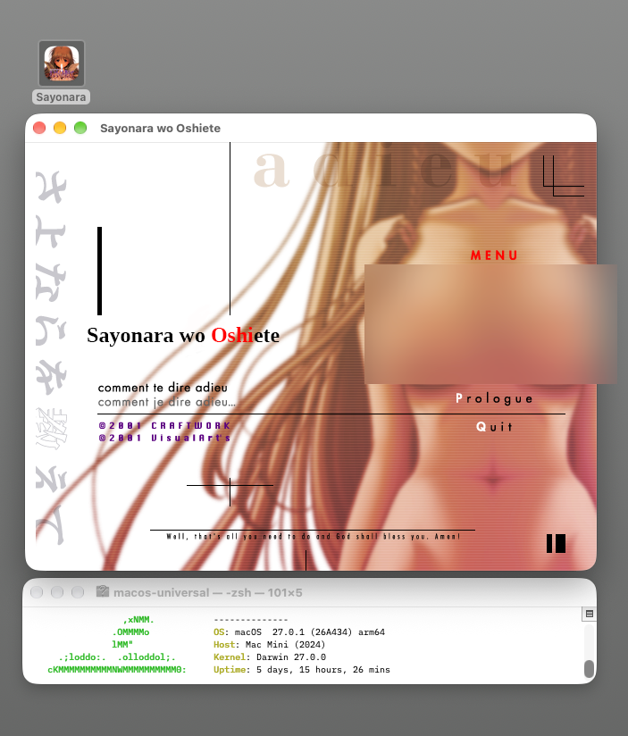
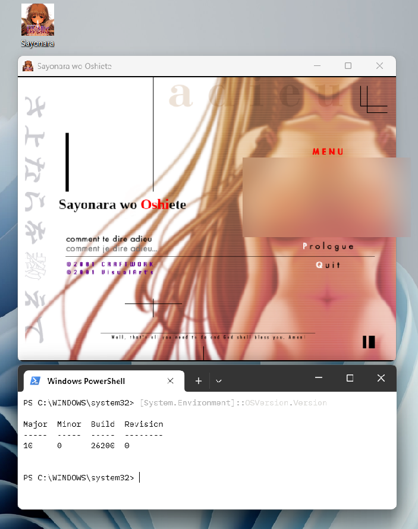

This project is a native C11 + SDL3 re-implementation of the SiglusEngine runtime, reverse-engineered to keep the visual
novel [Sayonara o Oshiete ~ Comment te Dire Adieu ~](https://en.wikipedia.org/wiki/Sayonara_o_Oshiete_~Comment_te_Dire_Adieu~) playable on Linux, Windows and macOS. The fan English patch v1.1 is supported as an overlay, with a language selector at start-up.

**No game files are included in this repository.** You need your own copy of the game. Everything game-related is
extracted at build time from the original archives. The engine binaries themselves are about 7 MB and
contain no game data.

This project is not affiliated with VisualArt's, or the [English patch's translators](https://x.com/sayooshiENG).

## Screenshots

The same engine runs natively on each platform. The title screen is shown here on macOS and Windows.

| macOS | Windows |
|---|---|
|  |  |

## Required input files

The builder accepts only these two archives in specific. The checksums have to match.

| Archive | SHA-256 |
|---|---|
| `Sayonara-o-Oshiete-Comment-te-Dire-Adieu_Win_JA_Download-Edition.zip`  | `fb61c609b6e11ea80efde830f2638f3b4aae53c72406edd5860b59519228a9ec` |
| `SayonaraWoOshiete_EnglishPatch_v1.1.zip` ([download](https://www.mediafire.com/file/okv1bm6grp45hpy/SayonaraWoOshiete_EnglishPatch_v1.zip/file)) | `88e6795ac5d656fe7be2956e5fc29f643ecc9d6e1aaafd3df5af6c289320e9fe` |

## Quickstart

Use the web builder or build from the source code. Both options result in the same executable.

**Web builder (no installation):**

1. Open the [web builder page](https://ak1122.cc/sayooshi) in a browser.
4. follow the insturcions from the web builder.

For more information, read [site/README.md](site/README.md).

**Build from the source code:**

1. Install the [build dependencies](#build-dependencies).
2. Put the two archives in `../assets`, next to this directory.
3. Run `make build`. For a Windows build, run `make build-windows`.
4. Start the game: `./dist/linux-x86_64/sayooshi`.

If a step fails, run `make check`. This command shows each missing dependency. Then read
[Dependencies](#dependencies).

## Build

### Dependencies


#### Build dependencies

**GNU make and a C compiler.** All targets need GNU make and a C11 compiler (gcc or clang).

- Debian, Ubuntu: `sudo apt install build-essential`
- Fedora: `sudo dnf install gcc make`
- Arch Linux: `sudo pacman -S base-devel`
- macOS: `xcode-select --install`

**7-Zip.** The build uses 7-Zip to extract the game archive and the installer of the English patch.

- Debian 12 or later, Ubuntu 24.04 or later: `sudo apt install 7zip`
- Older Debian and Ubuntu releases: `sudo apt install p7zip-full`
- Fedora: `sudo dnf install p7zip p7zip-plugins`
- Arch Linux: `sudo pacman -S 7zip`
- macOS: `brew install sevenzip`

**CMake and curl.** The first build downloads SDL 3.4.16 with curl (or wget) and examines its
SHA-256. Then CMake builds a static SDL library into `build/deps/`. This occurs one time for each
platform.

- Debian, Ubuntu: `sudo apt install cmake curl`
- Fedora: `sudo dnf install cmake curl`
- Arch Linux: `sudo pacman -S cmake curl`
- macOS: `brew install cmake` (macOS includes curl)

**SDL development headers (Linux only).** The Linux build needs the X11, Wayland and audio
development headers. The engine loads these libraries at run time. Thus the binary links only to
libc and libm.

- Debian, Ubuntu:
  ```
  sudo apt install libx11-dev libxext-dev libxrandr-dev libxcursor-dev libxi-dev libxfixes-dev \
    libxss-dev libxtst-dev libwayland-dev libxkbcommon-dev wayland-protocols libegl-dev \
    libasound2-dev libpulse-dev libpipewire-0.3-dev libdbus-1-dev libudev-dev libdrm-dev \
    libgbm-dev libdecor-0-dev
  ```
- Fedora:
  ```
  sudo dnf install libX11-devel libXext-devel libXrandr-devel libXcursor-devel libXi-devel \
    libXfixes-devel libXScrnSaver-devel libXtst-devel wayland-devel libxkbcommon-devel \
    wayland-protocols-devel mesa-libEGL-devel alsa-lib-devel pulseaudio-libs-devel \
    pipewire-devel dbus-devel systemd-devel libdrm-devel mesa-libgbm-devel libdecor-devel
  ```
- Arch Linux:
  ```
  sudo pacman -S libx11 libxext libxrandr libxcursor libxi libxfixes libxss libxtst wayland \
    libxkbcommon wayland-protocols mesa alsa-lib libpulse pipewire dbus systemd-libs libdrm libdecor
  ```

**Windows cross-compiler (optional).** `make build-windows` needs no installation. The build
downloads a pinned llvm-mingw toolchain and examines its SHA-256. If you have mingw-w64, the build
uses it.

- Debian, Ubuntu: `sudo apt install mingw-w64`
- Fedora: `sudo dnf install mingw64-gcc`
- Arch Linux: `sudo pacman -S mingw-w64-gcc`
- macOS: `brew install mingw-w64`

**Python 3.** `make site` uses Python 3 to put the engines into `site/`.

- Debian, Ubuntu: `sudo apt install python3`
- Fedora: `sudo dnf install python3`
- Arch Linux: `sudo pacman -S python`
- macOS: `brew install python`

#### Development dependencies

**Valgrind (Linux only).** `make valgrind`, `make helgrind` and `make drd` need Valgrind.

- Debian, Ubuntu: `sudo apt install valgrind`
- Fedora: `sudo dnf install valgrind`
- Arch Linux: `sudo pacman -S valgrind`

**ASan and UBSan runtimes.** `make dev SAN=1` needs the sanitizer runtimes. gcc on Debian, Ubuntu
and Arch Linux includes them. Xcode includes them on macOS.

- Fedora: `sudo dnf install libasan libubsan`

### Build steps

1. Put the two archives in `../assets`, next to this directory. Alternatively, use `JA_ZIP=FILE` and
   `EN_ZIP=FILE` on the command line.
2. Run `make check`. Install all missing dependencies.
3. Run `make build`. The result is `dist/linux-x86_64/sayooshi` (on macOS: `dist/macos-universal/Sayonara.app`).
4. Run `make build-windows` for Windows. The result is `dist/windows-x86_64/Sayonara.exe`.
5. Start the game: `./dist/linux-x86_64/sayooshi`.

### Other targets

- `make run` builds a development binary and starts it with the data in `build/data`. Use
  `RUN_ARGS="--lang en"` to give options.
- `make data` makes only the data tree.
- `make build-all` builds all targets that this host can build.
- `make clean` removes the objects. `make fclean` also removes `dist/`, the downloads and the data.
- `make info` shows the configuration. `make help` shows all targets and variables.

### Cross-compilation

- Linux to Windows: this works without more installation.
- Linux to macOS: this needs osxcross and an Apple SDK. You must get the SDK yourself.
- Alternatively, do the macOS build on a Mac.
- The macOS build is ad-hoc signed. It is not notarized. To start it the first time, right-click the app and
  select *Open*.

## Web builder

The web builder in `site/` makes the same executables in the browser. The user selects the two archives.
The page examines the SHA-256 of each archive. Then the page unpacks the archives in the
browser tab. The page adds the game data to an engine without game data. The page does not upload files.

- `make site` builds the engines this host can make (Linux or macOS, plus Windows) and puts them into
  `site/engines/`. It keeps the other targets from the last run. Run it on a Mac and on Linux, then commit.
- `make site-serve` starts a local server at http://localhost:8000.
- `make website` assembles the deployed site in `build/website`: `website/` at the root, the builder under `/sayooshi/`,
  stamped with the commit hash and its date. `make website-serve` serves it.
- To deploy, link the repository on Netlify. `netlify.toml` runs `tools/site/website.sh` and publishes `build/website`.
- For more information, read [site/README.md](site/README.md).

## Game controls

- **Language.** A selector (日本語 / English) shows first. It selects the last language that you used.
  The option `--lang ja` or `--lang en` skips the selector. To change the language during play, select
  Settings, then "Language / 言語".
- **Controls.** Click, Enter or Space: show the next text. Right-click or Esc: open the system menu.
  Hold Ctrl: skip. Mouse wheel up: open the backlog. F11 or Alt+Enter: full screen. Gamepads also
  operate the game.
- **Options.** `--scale N` sets the window size. `--nearest` makes the scaled image sharp.
  `--fullscreen` starts in full screen. `--help` shows all options.
- **Fonts.** The Japanese text uses a system font: MS Gothic, Hiragino, Noto CJK or IPA. If the
  system has no Japanese font, the game uses its built-in font (Kosugi). To use a different font,
  use `--font FILE`.
- **Windows.** The game shows no console window. Use `--console` to see the log. The game needs
  Windows 10 or later.

## Savefile paths

The game keeps all save files in one directory. The file format is cross platform compatible.

- Linux: [`~/.local/share/sayooshi/sayooshi/`](docs/SAVE_FORMAT.md#11-save-directories)
- Windows: [`%APPDATA%\sayooshi\sayooshi\`](docs/SAVE_FORMAT.md#11-save-directories)
- macOS: [`~/Library/Application Support/sayooshi/sayooshi/`](docs/SAVE_FORMAT.md#11-save-directories)

Portable mode, the export and import options and the file format are in
[docs/SAVE_FORMAT.md](docs/SAVE_FORMAT.md).
